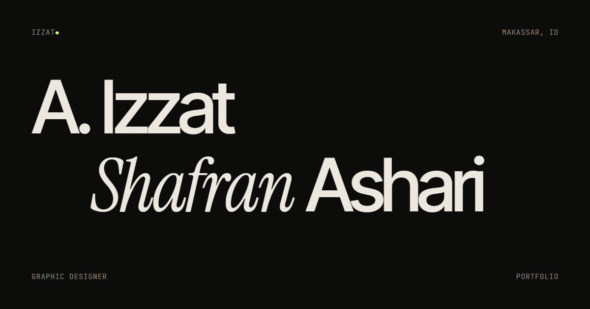

# A. Izzat Shafran Ashari — Portfolio

My personal portfolio website. I'm a graphic designer from Makassar, Indonesia, working
across branding, print, editorial and screen.



## About this site

A one-page, animated portfolio built with plain HTML, CSS and JavaScript — no framework
and no build step.

- Animated WebGL hero background (three.js shader)
- Smooth scrolling and scroll-driven animations (GSAP, ScrollTrigger, Lenis)
- Section-by-section colour changes, pinned project showcase, poster grid,
  toolkit wheel, award list with hover previews
- Mobile layout and a no-motion version for visitors with "reduce motion" switched on

## Structure

```
.
├── index.html            Page markup and SEO / social tags
└── assets/
    ├── css/styles.css    Styling and theme colours
    ├── js/
    │   ├── data.js       Site content (text, projects, links)
    │   ├── main.js       Rendering and animations
    │   └── hero-bg.js    Hero background
    └── images/           Projects, posters and share image
```

## Run locally

Open `index.html` in a browser. An internet connection is needed for the fonts and the
animation libraries, which load from CDNs.

## Built with

- [GSAP](https://gsap.com) + ScrollTrigger
- [Lenis](https://github.com/darkroomengineering/lenis)
- [three.js](https://threejs.org)
- Fonts: Inter Tight, Instrument Serif, JetBrains Mono (Google Fonts)

## Contact

- Email: hello@example.com
- Instagram / Behance / LinkedIn: _add your links here_

---

© A. Izzat Shafran Ashari. All rights reserved — the design and artwork in this
repository may not be reused without permission.
